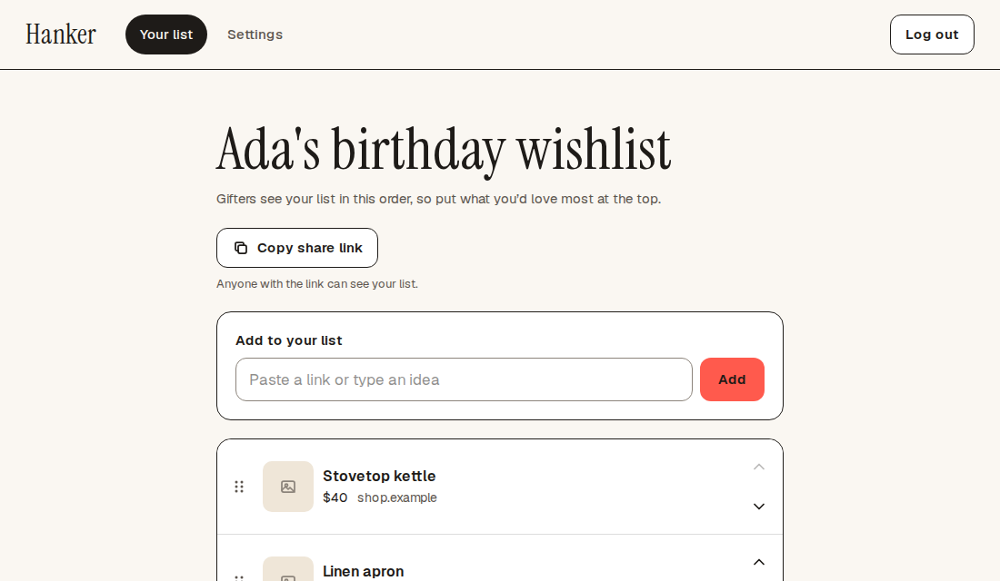

# Ted Armstrong (He/Him)

**Staff Software Engineer** · TypeScript, Node, NestJS, Postgres · Portland, Maine

[Résumé](https://shockolate.github.io/resume/) · [LinkedIn](https://www.linkedin.com/in/ted-armstrong/) · [hanker.dev](https://hanker.dev)

I'm a Staff Software Engineer working mostly on backend-heavy TypeScript systems with Node, NestJS and Postgres. I've built software for warehouse robots at 6 River Systems (acquired by Shopify) and for manufacturing floors at Lightforce and Dandy. I like owning a feature from the first design doc through on-call, and leaving the team better equipped to run it than I found it.

## Projects

<!-- To add a project, copy the <td> below and paste it beside the first one. -->
<table>
  <tr>
    <td valign="top" width="420">
      
       
      <b><a href="https://hanker.dev">Hanker</a></b>
       
      A wishlist app for family and friends. One list, one secret link, and nobody buys the same gift twice.
        
      Next.js · NestJS · Postgres · Drizzle · Vercel
      <ul>
        <li>Spoilers are enforced on the server, not the UI: <a href="https://github.com/Shockolate/wishlist-app/blob/main/apps/api/src/claims/projection.ts"><code>projectWishlist</code></a></li>
        <li>20 concurrent claims on the last unit: exactly one wins, <a href="https://github.com/Shockolate/wishlist-app/blob/main/docs/superpowers/specs/2026-10-07-wishlist-app-design.md#63-claim-concurrency">tested against real Postgres</a></li>
        <li>CI that can't quietly weaken its own secret isolation, via a <a href="https://github.com/Shockolate/wishlist-app/blob/main/scripts/workflow-policy.test.mjs">mutation-tested policy</a></li>
      </ul>
      <a href="https://hanker.dev">Live site</a> · <a href="https://github.com/Shockolate/wishlist-app">Source</a> · <a href="https://github.com/Shockolate/wishlist-app/blob/main/docs/superpowers/specs/2026-10-07-wishlist-app-design.md">Design spec</a>
    </td>
  </tr>
</table>
